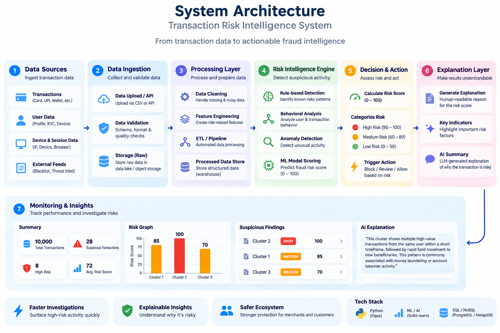

# RingWatch — Transaction Risk Intelligence

RingWatch is a local fraud-ring detection application. It detects groups of
accounts connected through shared devices or IP addresses, assigns each group a
transparent rule-based severity score, and uses Gemini to translate the
evidence into an analyst-friendly explanation.

> Detection decides **what** is suspicious. Gemini explains **why** it was
> flagged. Gemini does not decide the severity score.



## Features

- Local RingWatch login and risk dashboard
- CSV selection, validation, upload, and scan progress experience
- Graph-based detection of connected suspicious account clusters
- Deterministic severity scoring from 0 to 100
- Gemini explanations, confidence, and recommended action per cluster
- Severity chart and HIGH / MEDIUM / LOW risk cards
- Original standalone HTML network report remains available

## Architecture

```text
Browser dashboard
    │
    │  CSV upload + scan request (Flask session)
    ▼
app.py
    │ validates CSV and saves a separate uploaded copy
    ▼
explain_rings.run_pipeline(uploaded_csv)
    ├── detect_rings.py
    │   ├── builds an account graph with NetworkX
    │   ├── finds connected components with 3+ accounts
    │   └── applies deterministic severity rules
    └── Gemini API
        └── writes a plain-language explanation of existing signals
    │
    ▼
Flask JSON response → chart, summary cards, and cluster cards
```

### Detection and scoring

`detect_rings.py` creates an undirected graph:

- Each `account_id` is a node.
- An edge joins two accounts if they share a `device_id` or `ip_address`.
- Each connected component with at least **3 accounts** is a suspicious cluster.

The severity score is explainable and deterministic:

| Signal | Points |
| --- | ---: |
| All accounts in the cluster use one device | +40 |
| All accounts in the cluster use one IP address | +30 |
| Activity happens within 60 minutes | +30 |
| Activity happens within 24 hours (but not 60 minutes) | +15 |

Dashboard risk bands are based only on the calculated severity score:

| Score | Level | Dashboard color |
| --- | --- | --- |
| 90–100 | HIGH | Red |
| 60–89 | MEDIUM | Orange |
| 0–59 | LOW | Green |

## Project structure

```text
Ring_watch/
├── app.py                  # Flask routes, login, upload validation, scan API
├── detect_rings.py         # Graph detection and deterministic scoring
├── explain_rings.py        # Gemini explanation layer and reusable run_pipeline()
├── generate_data.py        # Optional synthetic-data generator
├── generate_report.py      # Original standalone HTML report generator
├── transactions.csv        # Prepared demo dataset
├── enriched_results.json   # Existing genuine Gemini explanations for demo data
├── requirements.txt        # Python dependencies
├── .env                    # Local secrets; never commit this file
├── templates/              # Login and dashboard HTML
├── static/                 # Browser JavaScript and styles
├── output/                 # Generated report and per-web-scan JSON outputs
├── uploads/                # Runtime copies of uploaded CSV files
├── lib/                    # Local assets used by the generated PyVis report
└── architecture.png        # Architecture diagram
```

`uploads/`, `output/web_scans/`, and `__pycache__/` are runtime artifacts. It
is safe to remove their contents when the application is not running.

## Requirements

- Python 3.10 or newer
- Internet access for fresh Gemini explanations on new files
- A Gemini API key

## Setup

Open PowerShell in the project root and install dependencies:

```powershell
python -m pip install -r requirements.txt
```

Create a `.env` file in the project root:

```text
GEMINI_API_KEY=your_gemini_api_key_here
```

Optional: set a stronger local Flask session secret:

```text
FLASK_SECRET_KEY=replace_with_a_long_random_value
```

Do not add `.env` to source control.

## Run the web dashboard

```powershell
python app.py
```

Open [http://127.0.0.1:5000](http://127.0.0.1:5000).

Demo login:

```text
Email:    demo@ringwatch.com
Password: ringwatch123
```

### Demo flow

1. Sign in with the demo account.
2. Select `transactions.csv`.
3. Click **Start security scan**.
4. Wait for the scanning stages to finish.
5. Review the summary, severity chart, and cluster cards.
6. Click a cluster card to show its account IDs and recommended action.

The prepared CSV contains three known suspicious clusters with severity scores
**85**, **100**, and **70**. The app saves an uploaded copy, so it does not
modify the original `transactions.csv`.

## CSV format

The web app accepts `.csv` files up to **10 MB**. These columns are required:

```text
account_id,device_id,ip_address,amount,timestamp
```

The demo file also includes `transaction_id` and `ring_label`.
`ring_label` is only a synthetic-data answer key; it is never used by detection
or scoring.

## Web routes

| Route | Method | Purpose |
| --- | --- | --- |
| `/` | GET | Redirects to login or dashboard |
| `/login` | GET, POST | Displays and submits the demo login |
| `/dashboard` | GET | Protected risk dashboard |
| `/upload` | POST | Validates and stores a CSV copy |
| `/scan` | POST | Runs detection, scoring, and explanation pipeline |
| `/logout` | GET | Clears the local session |

## Original command-line workflow

The web dashboard does not replace the original report workflow.

```powershell
# Optional: create a new synthetic transaction dataset.
# This overwrites transactions.csv.
python generate_data.py

# Run graph detection and print clusters/scores.
python detect_rings.py

# Generate Gemini explanations and enriched_results.json.
python explain_rings.py

# Generate the standalone PyVis HTML report.
python generate_report.py
```

Open `output/report.html` in a browser. It includes a network graph where
flagged account nodes are red.

## Gemini behavior

For a new CSV, Gemini receives only the cluster’s structured evidence (counts,
time span, amount, and score), not raw transaction rows. Gemini returns:

- `explanation`
- `confidence`
- `recommended_action`

For the included demo CSV only, if Gemini is temporarily unreachable, the app
can reuse the existing genuine explanation when all evidence fields exactly
match the saved demo result. It never creates a placeholder explanation or
applies that cached explanation to a different uploaded cluster.

## Troubleshooting

| Problem | What to check |
| --- | --- |
| `ModuleNotFoundError` | Run `python -m pip install -r requirements.txt`. |
| Scan reports a Gemini/configuration failure | Check `.env`, `GEMINI_API_KEY`, and internet connectivity; restart `python app.py`. |
| Dashboard looks unchanged after an update | Restart Flask, then hard-refresh with `Ctrl + F5`. |
| CSV is rejected | Confirm it is non-empty, under 10 MB, and contains all five required columns. |
| Port 5000 is already in use | Stop the previous Flask process, then run `python app.py` again. |

## Limitations

- The bundled data is synthetic and should not be treated as real payment data.
- Detection currently uses only shared device and IP relationships.
- Scores are rule-based rather than trained from production fraud labels.
- The demo login is local-only and is not production authentication.
- The Flask server runs in debug mode for local development only.

## Suggested next steps

- Add more signals: payment instrument, bank account, velocity, location, and
  behavioral patterns.
- Record reviewer decisions to calibrate rules and reduce false positives.
- Add asynchronous job handling for large data files.
- Replace demo login with an organization-approved authentication provider
  before any real deployment.
